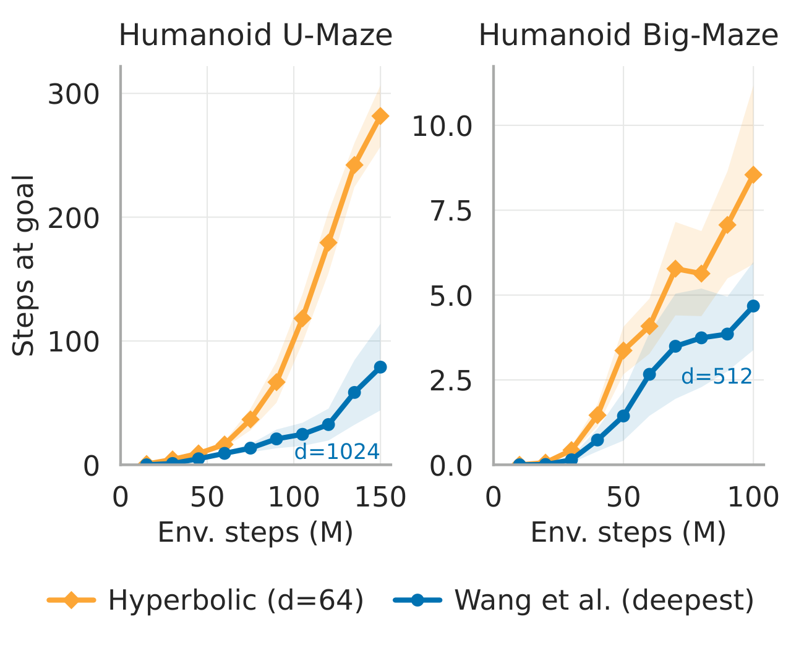
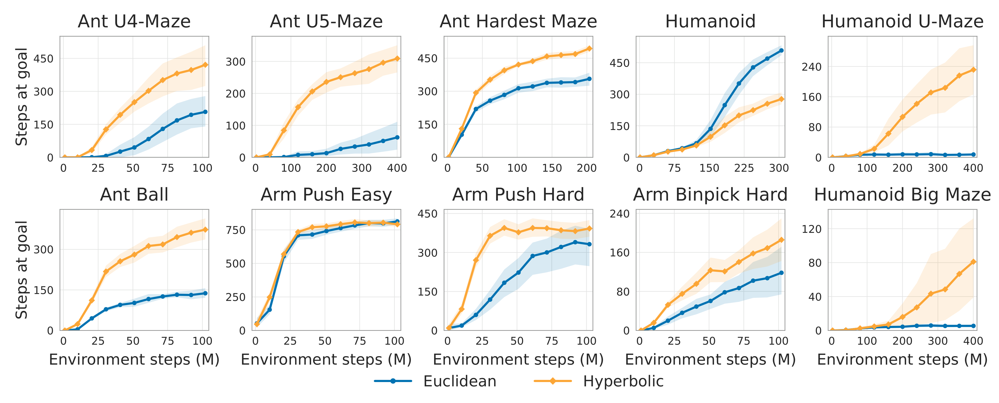

<div align="center">

# Outperforming 1000 Euclidean Layers With Hyperbolic Goal-Conditioned RL

**Timo Klein**<sup>\*</sup> · **Thomas Lang**<sup>\*</sup> · **Andrii Shkabrii** · **Lukas Miklautz** · **Yllka Velaj** · **Sebastian Tschiatschek**

<sup>\*</sup>Equal contribution

*Preprint*

[](https://arxiv.org/abs/2610.20009)
[](https://www.python.org/)
[](https://github.com/jax-ml/jax)
[](LICENSE)



</div>

**Hyperbolic CRL** keeps the contrastive objective of contrastive reinforcement learning (CRL) but measures how reachable a goal is by the **geodesic distance in hyperbolic space** instead of the Euclidean distance. In mazes, walls make the route distance to a goal deviate from the straight-line distance, and the deviation grows with the length of the route: the geometry is close to flat locally and tree-like globally, which is the structure hyperbolic space captures.

- **Inductive bias beats scale.** On the hard Humanoid mazes, depth 64 hyperbolic agents outperform the Euclidean agents with 512 and 1024 layers from [1000 Layer Networks for Self-Supervised RL](https://arxiv.org/abs/2503.14858) (Wang et al., NeurIPS 2025) while training more than 12× faster and using about 13× fewer parameters.
- **Better at fixed depth.** At depth 16, hyperbolic agents outperform Euclidean ones on most of the 10 JaxGCRL tasks and stitch long routes more reliably.
- **Online and offline.** The same change improves offline CRL on all eight OGBench navigation tasks we evaluate.

## Installation

The code requires Python ≥ 3.12 and uses [uv](https://docs.astral.sh/uv/) for the environment. On Linux, JAX is installed with CUDA 12 support.

```bash
git clone https://github.com/Probabilistic-and-Interactive-ML/HypGCRL.git
cd HypGCRL
uv sync
source .venv/bin/activate
```

## Reproducing the paper

### Online (JaxGCRL)

Run-level flags come before the agent (`crl` or `hyp-crl`), and agent flags after it. The defaults are the hyperparameters in Table 1 of our paper, which follow Table 7 of [1000 Layer Networks for Self-Supervised RL](https://arxiv.org/abs/2503.14858). The main results only need the environment, the budget, the depth and the seed:

```bash
# Euclidean CRL
python run.py --env ant_u4_maze --total_env_steps 100000000 --seed 0 \
    crl --actor_depth 16 --critic_depth 16

# Hyperbolic CRL
python run.py --env ant_u4_maze --total_env_steps 100000000 --seed 0 \
    hyp-crl --actor_depth 16 --critic_depth 16 \
    --manifold hyperboloid --hyp_energy_fn geodesic --curvature 0.5
```

| `--total_env_steps` | Environments |
|---|---|
| 100M | `ant_u4_maze`, `ant_ball`, `arm_push_easy`, `arm_push_hard`, `arm_binpick_hard` |
| 200M | `ant_hardest_maze` |
| 300M | `humanoid` (add `--num_evals 600`) |
| 400M | `ant_u5_maze`, `humanoid_u_maze`, `humanoid_big_maze` |

- **Figure 4** uses depth 16 and seeds 0–9. `ant_u4_maze` and `ant_u5_maze` are evaluated on far goals (`ant_u4_maze_eval`, `ant_u5_maze_eval`) by default.
- **Figure 1** uses `--actor_depth 64 --critic_depth 64` for the hyperbolic agent and seeds 0–4, at the total steps used in [1000 Layer Networks for Self-Supervised RL](https://arxiv.org/abs/2503.14858): `humanoid_u_maze` with `--total_env_steps 150000000 --num_evals 150` and `humanoid_big_maze` with `--total_env_steps 100000000 --num_evals 100`.
- **Depth and curvature ablations (Figures 7 and 8)** change `--actor_depth`/`--critic_depth` and `--curvature`.
- **Stitching (Figure 6)** trains on `ant_u_maze_gen_1f2f3f` with seeds 0–9 and evaluates on far goals with `--eval_env ant_u_maze_eval`.
- **Humanoid** runs at the 0.0015 s physics substep (Appendix C.3), which is what the pinned Brax version applies to `humanoid`.

The main metric is steps at goal, logged as `eval/episode_success`.

### Offline (OGBench)

```bash
# Euclidean CRL (OGBench reference)
jaxgcrl-offline --env_name antmaze-giant-navigate-v0 --seed 0 crl

# Hyperbolic CRL with the hyperbolic actor
jaxgcrl-offline --env_name antmaze-giant-navigate-v0 --seed 0 hyp-crl \
    --manifold hyperboloid --hyp_energy_fn minkowski --curvature 0.1 \
    --hyp_actor --hyp_actor_curvature 0.5
```

Figure 9 and Table 3 use eight tasks and seeds 0–7: `antmaze-{giant-navigate, medium-stitch, large-stitch}-v0` and `humanoidmaze-{medium-navigate, large-navigate, giant-navigate, medium-stitch, large-stitch}-v0`. On the four stitch tasks, we adds `--manifold_float64` to the hyperbolic agent.
The per-task hyperparameters of OGBench (BC coefficient, discount, goal sampling) are set automatically from `--env_name`.
Datasets are downloaded to `~/.ogbench/data` (change with `--dataset_dir`). The score is `evaluation/overall_success` averaged over the last three evaluations.

### Outputs

Each run writes to `runs/run_<exp_name>_s_<seed>/`: the configuration (`args.pkl`), the metrics as CSV, and the final parameters (`ckpt/final.pkl`). Add `--log_wandb` to also log to Weights & Biases.

<div align="center">

</div>

## Repository structure

```
run.py                     # online entry point (jaxgcrl)
jaxgcrl/
├── hyperbolic.py          # exponential map, hyperbolic linear layers, geodesic and Minkowski energies
├── online/                # deep residual CRL: configs, networks, losses, training loop
├── offline/               # OGBench CRL: configs, networks, learner, data, evaluation (jaxgcrl-offline)
├── envs/                  # JaxGCRL goal-conditioned environments
└── utils/                 # environment registry, evaluator, replay buffer, logging
```

## Citation

```bibtex
@article{klein2026outperforming,
  title   = {Outperforming 1000 Euclidean Layers With Hyperbolic Goal-Conditioned RL},
  author  = {Klein, Timo and Lang, Thomas and Shkabrii, Andrii and Miklautz, Lukas and Velaj, Yllka and Tschiatschek, Sebastian},
  journal = {arXiv preprint arXiv:2610.20009},
  year    = {2026}
}
```

## Acknowledgements

This codebase builds on [JaxGCRL](https://github.com/MichalBortkiewicz/JaxGCRL) for the online environments and training loop, on [scaling-crl](https://github.com/wang-kevin3290/scaling-crl) for the deep residual architecture, and on [OGBench](https://github.com/seohongpark/ogbench) for the offline agent and data pipeline. The hyperbolic operations come from [hyperbolix](https://github.com/timoklein/hyperbolix).

## Licenses

The code in this repository is released under the [Apache 2.0 License](LICENSE). Parts adapted from other projects keep their original licenses, listed in [THIRD_PARTY_NOTICES.md](THIRD_PARTY_NOTICES.md). The OGBench datasets are downloaded from their original source under their own terms.
